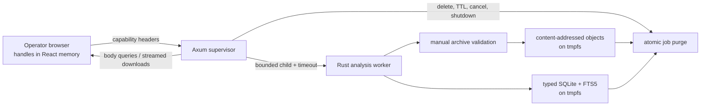

# Architecture

The Axum supervisor serves the compiled React application and owns the only
in-memory map from capability digests to active jobs. A successful upload
returns a random 256-bit capability once, in `X-MDM-Job-Handle`. Only its
BLAKE3 digest is retained by the server.

Each analysis runs in a child process with no inherited standard streams,
disabled core dumps, bounded file descriptors, a wall-clock deadline, and a
parent cancellation token. The worker manually validates and extracts ZIP,
ZIP64, nested ZIP, and CAB members into content-addressed objects. It rejects
unsafe paths, links and special files, Unicode/case collisions, excessive
expansion, archive bombs, nesting, counts, and malformed inputs.
An ETL member that alone exceeds the per-entry ratio is never expanded or made
downloadable: the worker hashes only its bounded compressed bytes and records
explicit unsupported coverage. The aggregate archive, declared expanded size,
file size, file count, and nesting limits still apply.

The worker creates a typed SQLite database in a staging filename, parses each
supported artifact as a stream, correlates normalized evidence, runs rule pack
`2026.09`, then atomically renames the completed database. SQLite uses bundled
FTS5 and memory-backed temporary storage. Unknown/unsupported sources become
coverage records instead of silently disappearing.

Comparison accepts two independent capability headers, computes device identity
confidence, and reads both active indexes. It never writes a comparison record.
High confidence permits longitudinal new/resolved/persistent language; uncertain
identity is limited to side-by-side current state and coverage.

The public surface is limited to liveness, readiness, limits, sanitized build
metadata, OpenAPI, and static assets. There are intentionally no login, user,
job-list, history, share, audit, backup, or telemetry endpoints.
