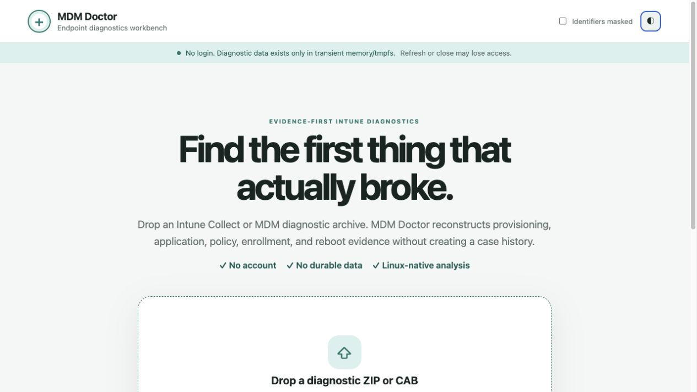
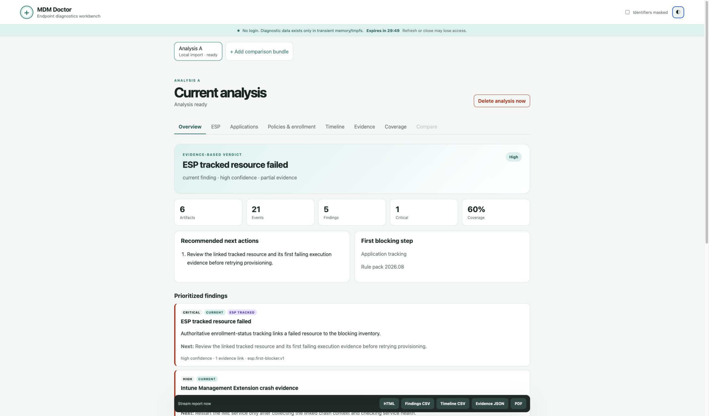
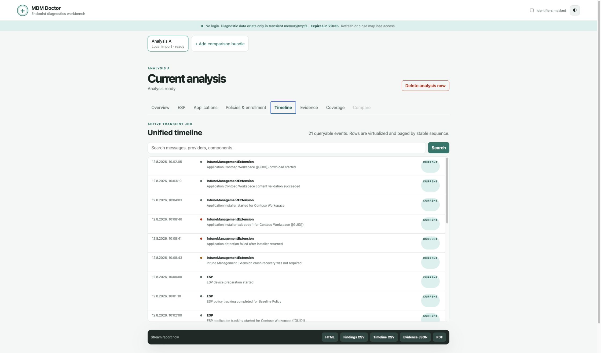
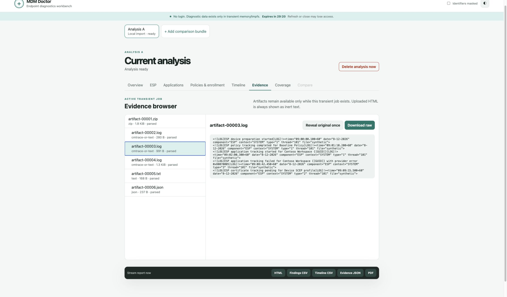
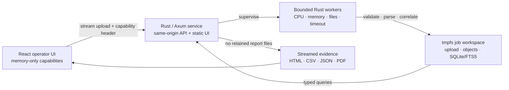

<div align="center">

# MDM Doctor

**Evidence-first diagnostics for Microsoft Intune and Windows MDM.**

Turn large diagnostic bundles into a prioritized verdict, correlated timeline,
ESP state, application attempts, collection coverage, and evidence-backed next
steps — without accounts, telemetry, or durable diagnostic storage.

[](https://github.com/Darkatek7/mdm-doctor/actions/workflows/ci.yml)
[](https://github.com/Darkatek7/mdm-doctor/actions/workflows/publish-container.yml)
[](https://github.com/Darkatek7/mdm-doctor/pkgs/container/mdm-doctor)
[](LICENSE)
[](ARCHITECTURE.md)

[Quick start](#quick-start) · [Explore the UI](#explore-the-ui) ·
[Security model](#security-model) · [Architecture](#architecture) ·
[Development](#development)



</div>

> [!IMPORTANT]
> MDM Doctor deliberately has no authentication layer. Run it on localhost, a
> VPN, or a protected internal network. Never expose it directly to the public
> internet.

## Why MDM Doctor?

An Intune diagnostic bundle can contain hundreds of logs and several versions
of the same story. MDM Doctor correlates those sources before it makes a claim:

| Capability | What it gives you |
| --- | --- |
| Evidence-first verdict | A prioritized current finding with confidence, evidence completeness, and the first proven blocking step. |
| ESP reconstruction | Authoritative expected-versus-actual resource tracking without treating every application error as an ESP blocker. |
| Application lifecycle | Win32/MSI attempts, exit-code semantics, detection state, reboot correlation, and historical-versus-current outcomes. |
| Unified timeline | Stable, searchable, paginated, and virtualized events normalized to UTC while preserving source timestamps. |
| Evidence browser | Redacted previews, parser provenance, safe raw download, and direct links from findings back to active artifacts. |
| Coverage, exports, comparison | Explicit missing/unsupported sources, streamed HTML/CSV/JSON/PDF reports, and transient two-bundle comparison. |

## Quick start

The published image is a single multi-architecture manifest. Docker selects
`linux/amd64` or `linux/arm64` automatically.

```sh
git clone https://github.com/Darkatek7/mdm-doctor.git
cd mdm-doctor
cp .env.example .env

export MDM_DOCTOR_IMAGE=ghcr.io/darkatek7/mdm-doctor:latest
docker compose pull
docker compose up -d --no-build
```

Open **http://127.0.0.1:8080** and drop an Intune Collect or MDM diagnostic
ZIP/CAB into the browser.

For a reproducible deployment, pin the image digest shown on the
[package page](https://github.com/Darkatek7/mdm-doctor/pkgs/container/mdm-doctor):

```sh
MDM_DOCTOR_IMAGE="ghcr.io/darkatek7/mdm-doctor@sha256:<digest>" \
  docker compose up -d --no-build
```

The recommended host has at least 12 GiB available memory and 8 GiB available
for tmpfs. Keep `BIND_ADDRESS=127.0.0.1`; use `0.0.0.0` only on a trusted LAN or
VPN with host firewall rules in place.

## Explore the UI

### Start with the verdict

MDM Doctor separates an observed error from a proven root cause. The overview
shows the current verdict, confidence, coverage, first authoritative blocker,
and the next action backed by linked evidence.



### Follow the sequence, then inspect the source

| Unified timeline | Redacted evidence browser |
| --- | --- |
|  |  |
| Search normalized events while keeping current and historical evidence distinct. | Resolve findings to parser provenance and source spans without exposing identifiers by default. |

All screenshots above were generated from deliberately fictional synthetic
fixtures with redaction enabled. No real diagnostic bundle, endpoint identity,
report, or derived customer evidence is stored in this repository.

## Supported diagnostics

MDM Doctor manually validates and ingests ZIP, ZIP64, nested ZIP, and CAB
archives. Recognized evidence includes:

- CMTrace logs and rotations, Windows EVTX, MDM XML/HTML, REG, JSON, and CSV
- Intune Management Extension state, application and MSI execution evidence
- Enrollment Status Page tracking, provisioning phases, and blocking resources
- `dsregcmd`, enrollment/token context, policies, certificates, SCEP, and network profiles
- Collection coverage for optional, missing, unsupported, and malformed sources

ETL and unknown database schemas are reported explicitly as unsupported
coverage; uploaded HTML is never rendered.

## Security model

MDM Doctor treats diagnostic archives as hostile input and treats privacy as a
lifecycle property, not an export option.

- Uploads are streamed while hashing and enforcing configured limits.
- Archive entries are validated individually; traversal, links, special files,
  Unicode/case collisions, bombs, excessive nesting, and malformed paths are
  rejected.
- Every job receives a random 256-bit capability held only in React memory.
  Handles never enter URLs, response bodies, cookies, browser storage, or logs.
- Uploads, extracted objects, SQLite/FTS indexes, previews, and report inputs
  exist only in a capability-scoped tmpfs directory.
- Delete, cancellation, failure, timeout, TTL expiry, export failure, and
  graceful shutdown purge the whole job workspace.
- Redaction defaults to on. Raw evidence requires an explicit reveal action;
  unredacted exports require confirmation.
- The service has no accounts, login, job listing, case history, audit history,
  access logs, telemetry, crash uploads, persistent metrics, or backups.

Read [SECURITY.md](SECURITY.md) before trusted-LAN deployment. Please report
vulnerabilities using the private process documented there, not a public issue.

## Architecture



One container serves the compiled UI and supervises isolated child workers.
The runtime is non-root with a read-only root filesystem, dropped capabilities,
disabled core dumps, internal networking, no access log, and tmpfs-only writable
paths. See [ARCHITECTURE.md](ARCHITECTURE.md) for the data model, trust
boundaries, deterministic IDs, and rule evaluation flow.

## Configuration

The defaults are intentionally conservative:

| Limit | Default |
| --- | ---: |
| Upload / expanded job | 1 GiB / 4 GiB |
| Single expanded file | 1 GiB |
| Files / archive depth | 100,000 / 4 |
| Entry / aggregate compression ratio | 100:1 / 50:1 |
| Parsed events | 1.25 million |
| Workers / uploads / active jobs | 2 / 2 / 4 |
| Job / parser timeout | 20 minutes / 120 seconds |
| Idle TTL | 30 minutes |

Review [.env.example](.env.example) for every configurable limit. Global
admission control prevents configured jobs from overcommitting the tmpfs
budget.

### Optional TLS proxy

Administrator-supplied, read-only certificates can be used with the included
Nginx example:

```sh
TLS_CERTIFICATE_PATH=/absolute/server.crt \
TLS_PRIVATE_KEY_PATH=/absolute/server.key \
docker compose -f compose.yaml -f compose.tls.yaml up -d
```

Review the source-IP restriction in
[deploy/nginx/nginx.conf](deploy/nginx/nginx.conf) before trusted-LAN use. TLS
does not make public exposure safe.

## Development

Requirements: Rust 1.88 or later and Node.js 24 or later.

```sh
cargo fmt --all --check
cargo clippy --workspace --all-targets --all-features --locked -- -D warnings
cargo test --workspace --all-features --locked

cd web
npm ci --ignore-scripts
npm run types:generate
npm run typecheck
npm test
npm run build
cd ..

WORKSPACE_PATH="$(mktemp -d)" STATIC_DIR="$PWD/web/dist" \
  cargo run --locked -- serve
```

Analyze an already extracted local folder without modifying its contents:

```sh
WORKSPACE_PATH="$(mktemp -d)" STATIC_DIR="$PWD/web/dist" \
  cargo run --locked -- serve --import-folder /absolute/path/to/extracted-bundle
```

Only regular files are copied into the transient workspace. Links and special
files are rejected, and the one-time capability is exposed only to the in-memory
UI that claims the import.

### Build the container locally

```sh
docker compose up -d --build
```

If enterprise TLS inspection is required during dependency download, pass its
PEM bundle as a BuildKit secret. It is not copied into an image layer:

```sh
docker build --secret id=corporate_ca,src=/absolute/corporate-ca.pem \
  -t mdm-doctor:local .
```

Do not disable npm or Cargo TLS verification.

## Contributing and license

Issues and focused pull requests are welcome. Changes to ingestion, parsers,
redaction, export, or lifecycle behavior should include synthetic fixtures and
tests that prove cleanup and evidence resolution.

MDM Doctor is licensed under [Apache-2.0](LICENSE). Dependency licensing and
clean-room provenance are documented in [LICENSES.md](LICENSES.md).
